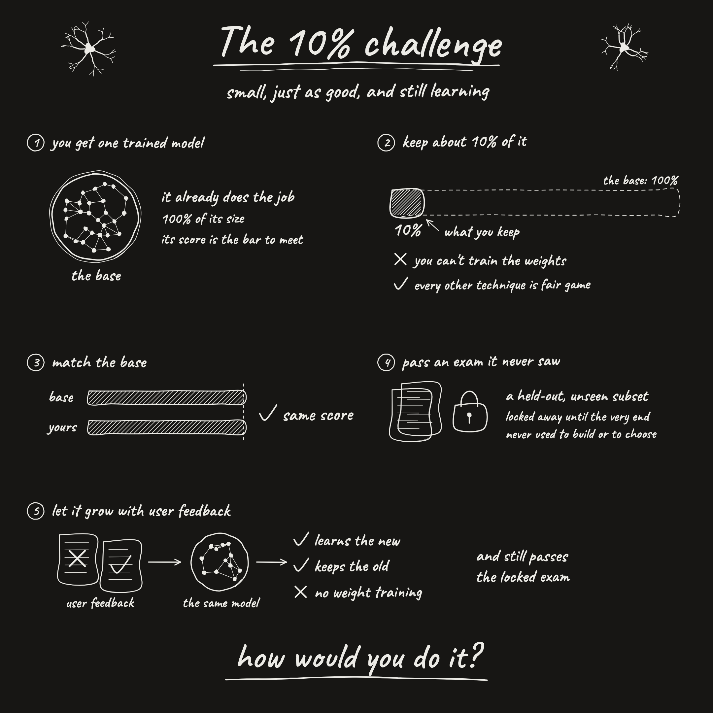

# The 10% challenge

Small, just as good, and still learning.

**Prize: 1,000 USD** for the best complete, working proof submitted by the deadline.

## The challenge

1. **Start from one trained model.** Any model is fine, as long as it is above 0.5B parameters, either before or after you cut it. Pick a commercial-class task: anything commercial or of decent utility, nothing toy-shaped and nothing with a really narrow distribution. The model already does the job, and its score is the bar to meet.
2. **Keep at most 10% of its fp16 size.** You can't train the weights. Every other technique is fair game, within the rules below.
3. **Match the base.** Your model gets the same score as the one you started from.
4. **Pass an exam it never saw.** Set aside a held-out, unseen exam before you begin (see rule 3 below). Keep it locked away until the very end, and never use it to build or to choose.
5. **Let it grow with user feedback.** Feedback means annotation or labelling, where someone marks the model's work, with very few samples, the way a real user would give it. It learns the new and keeps the old, still with no weight training, and it still passes the locked exam.

## How entries are judged

1. **Size counts everything.** On-disk bytes of everything you ship (weights, tokenizer, code, feedback storage) against the fp16 size of the model you started from.
2. **Same means faithful.** Keep at least 98% of the exam items the original got right, and at least 95% within every kind of item (each answer class, source or category). A higher score from different behaviour doesn't count as matching.
3. **The exam is unseen ground.** At least 2,000 locked items, with at least 300 for every kind of item. At least 500 of them come from a source or time period you never built, tuned or calibrated on.
4. **No new trained parts.** Don't add new computation fitted to data: no heads, classifiers, adapters (LoRA included), or side memory the system looks answers up from, and no feedback placed in the prompt. The answer has to come from the original model's own computation.
5. **Feedback has to teach.** At most 25 annotated items, marking real mistakes the way a user would. Lock at least 25 unseen items about what the feedback teaches before giving any feedback. On those the model must clearly improve, without breaking the nearby exam items the feedback could affect.
6. **Prove the learning came from the feedback.** Also run the same feedback with shuffled labels, and an empty feedback. Both must do clearly worse than your real feedback.
7. **Do the real job.** The model keeps the task's real output. Turning it into a multiple-choice stand-in doesn't count.
8. **The original must have something to keep.** It scores well above chance on the exam and below its ceiling.
9. **Spirit over letter.** Readings that follow the wording but defeat the purpose are rejected.

## The maintainer's check

Ship the artifact, the locked files, one command that answers questions and one that takes annotated items as feedback. Before any prize is paid, I'll run your system on my own held-out data from a different distribution and give it my own feedback. It has to keep working and keep learning there, with no new computation fitted to data and no side memory it looks answers up from.

## Submit

Submit your proof by [opening a GitHub issue](https://github.com/DeusExperiments/ten-percent-challenge/issues/new) on this repo by **12 November 2026, 17:05 UTC** (7 days from [the announcement](https://x.com/tokenbender/status/2118389310982643779)). Entries stay open until the deadline. Among the entries that pass every rule, the best one wins the prize.

How would you do it?
